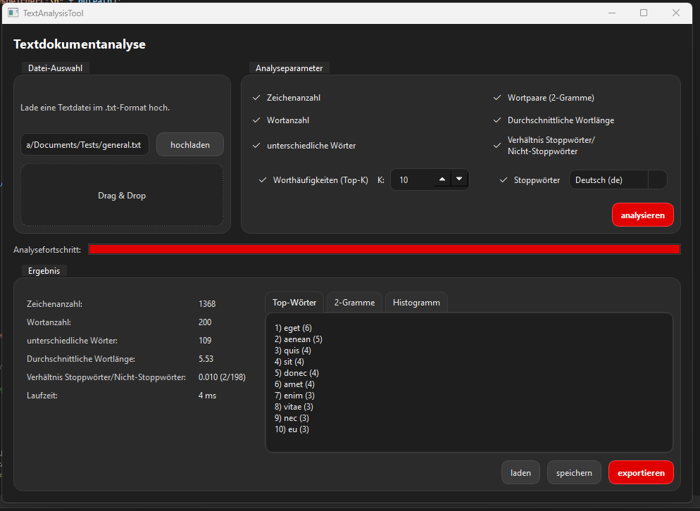
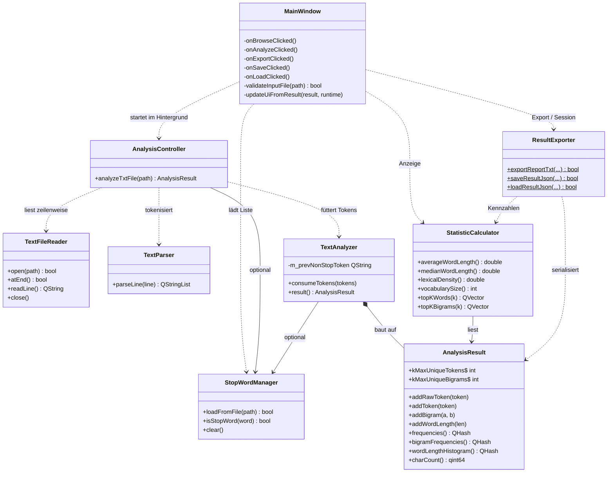

# TextAnalysisTool

Desktop-Anwendung zur statistischen Analyse von Textdateien, entwickelt in **C++17 mit Qt 6**.
Das Tool liest `.txt`-Dateien bis 50 MB zeilenweise ein und berechnet Wortstatistiken wie
Worthäufigkeiten, Bigramme, Wortlängenverteilung und lexikalische Dichte – optional mit
Stoppwortfilter für Deutsch und Englisch.



## Funktionen

- **Kennzahlen:** Zeichenanzahl, Wortanzahl, Anzahl unterschiedlicher Wörter, durchschnittliche
  und mediane Wortlänge, lexikalische Dichte, Verhältnis Stoppwörter / Nicht-Stoppwörter
- **Top-K-Wörter und Top-K-Bigramme** (K einstellbar)
- **Wortlängen-Histogramm**
- **Stoppwortfilter** (de/en), Listen als Qt-Ressource in die Anwendung eingebettet
- **Unicode-fähige Tokenisierung:** Umlaute, Ziffern, Wörter mit Binnen-Apostroph oder -Bindestrich
  (`don't`, `E-Mail`)
- **Session speichern/laden** als JSON, **Report-Export** als UTF-8-Textdatei
- **Datei-Auswahl** per Dialog oder Drag & Drop
- **Performance-Log:** jede Analyse wird mit Laufzeit und Kennzahlen in `analysis_log.csv` protokolliert

## Technische Umsetzung

| Thema | Umsetzung |
|---|---|
| Große Dateien | Streaming: Datei wird zeilenweise gelesen, Statistiken werden inkrementell aufgebaut – der Text liegt nie vollständig im Speicher |
| Responsive UI | Analyse läuft im Hintergrund über `QtConcurrent::run` + `QFutureWatcher`; Eingaben sind währenddessen gesperrt |
| Top-K | Min-Heap der Größe K: O(n log K) statt Sortierung der gesamten Häufigkeitstabelle |
| Median | Direkt aus dem Histogramm berechnet, ohne die Wortlängen einzeln zu speichern |
| Robustheit | Prüfung der Eingabedatei (Existenz, Lesbarkeit, Endung, max. 50 MB); Obergrenze von je 1 Mio. unterschiedlichen Wörtern/Bigrammen gegen Speicherexplosion bei pathologischen Eingaben |
| Sicherheit | CSV-Log gegen Formel-Injection gehärtet (Felder mit `= + - @` am Anfang werden entschärft) |

### Architektur

```
src/
├── ui/            MainWindow – Qt-Widgets-Oberfläche, Drag & Drop, Async-Steuerung
├── application/   AnalysisController – orchestriert Einlesen, Parsen und Analysieren
├── import/        TextFileReader (Streaming, UTF-8), TextParser (Regex-Tokenisierung)
├── analysis/      TextAnalyzer (Zählen), StopWordManager, StatisticCalculator (abgeleitete Kennzahlen)
├── model/         AnalysisResult – Rohdaten der Analyse (Häufigkeiten, Bigramme, Histogramm)
└── export/        ResultExporter – TXT-Report, JSON speichern/laden
```



**Ablauf einer Analyse:** `MainWindow` prüft die Datei, lädt die Stoppwortliste und startet den
`AnalysisController` über `QtConcurrent` in einem Hintergrund-Thread. Der Controller liest die Datei
zeilenweise (`TextFileReader`), zerlegt jede Zeile in Tokens (`TextParser`) und übergibt sie an den
`TextAnalyzer`, der das `AnalysisResult` inkrementell aufbaut. Abgeleitete Kennzahlen wie Median oder
Top-K berechnet der `StatisticCalculator` erst bei Bedarf aus diesem Ergebnis.

Alle Klassen unterhalb von `MainWindow` sind frei von UI-Code und werden direkt in den Unit-Tests
verwendet. `TextImporter` und `TextDocument` sind einfache Hilfsklassen, die in der Analyse-Pipeline
derzeit nicht verwendet werden.

## Performance

Gemessen im Release-Build (Windows 11, MSVC 2022) mit synthetischen Testdaten aus dem
mitgelieferten `TestDataGenerator`, Mittel aus drei Läufen:

| Dateigröße | Tokens | Laufzeit |
|---:|---:|---:|
| 1 MB | 182 000 | ≈ 0,1 s |
| 10 MB | 1,8 Mio. | ≈ 1,0 s |
| 49 MB | 8,9 Mio. | ≈ 4,9 s |

Die Laufzeit wächst linear mit der Dateigröße.

## Build

**Voraussetzungen:** CMake ≥ 3.16, C++17-Compiler (getestet mit MSVC 2022), Qt 6 mit den Modulen
Core, Widgets, Concurrent und Test (getestet mit Qt 6.10).

```bash
# Pfad zur Qt-Installation angeben, z. B. C:/Qt/6.10.2/msvc2022_64
cmake -B build -DCMAKE_PREFIX_PATH=<Qt-Pfad>
cmake --build build
```

Alternativ mit den mitgelieferten Presets (Windows, Ninja): Umgebungsvariable `QTDIR` auf die
Qt-Installation setzen und `cmake --preset x64-release` ausführen – oder das Projekt in Visual Studio
als CMake-Ordner öffnen.

## Tests

Unit-Tests mit **QtTest** decken Tokenisierung (inkl. Umlaute), Stoppwortbehandlung,
Zählung und Bigramme (auch über Zeilengrenzen), abgeleitete Kennzahlen sowie den
JSON-Roundtrip und den Report-Export ab.

```bash
ctest --test-dir build --output-on-failure
```

### Testdaten erzeugen

```bash
# ca. 10 MB, Vokabular zyklisch
TestDataGenerator --out test_10mb.txt --mb 10 --vocab "haus,garten,baum,auto,stadt,fluss,berg,see"

# exakt 1000 Tokens, pseudozufällig mit festem Seed
TestDataGenerator --out sample.txt --tokens 1000 --vocab "a,b,c" --mode random --seed 42
```
